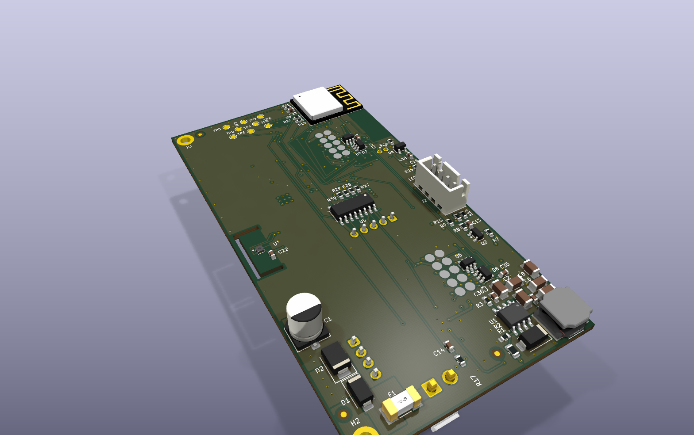
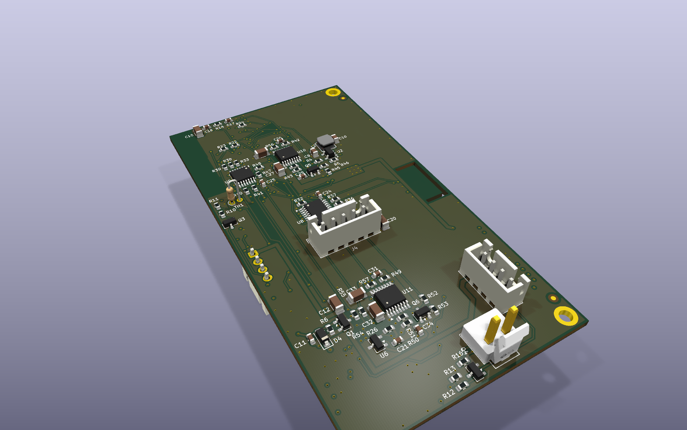
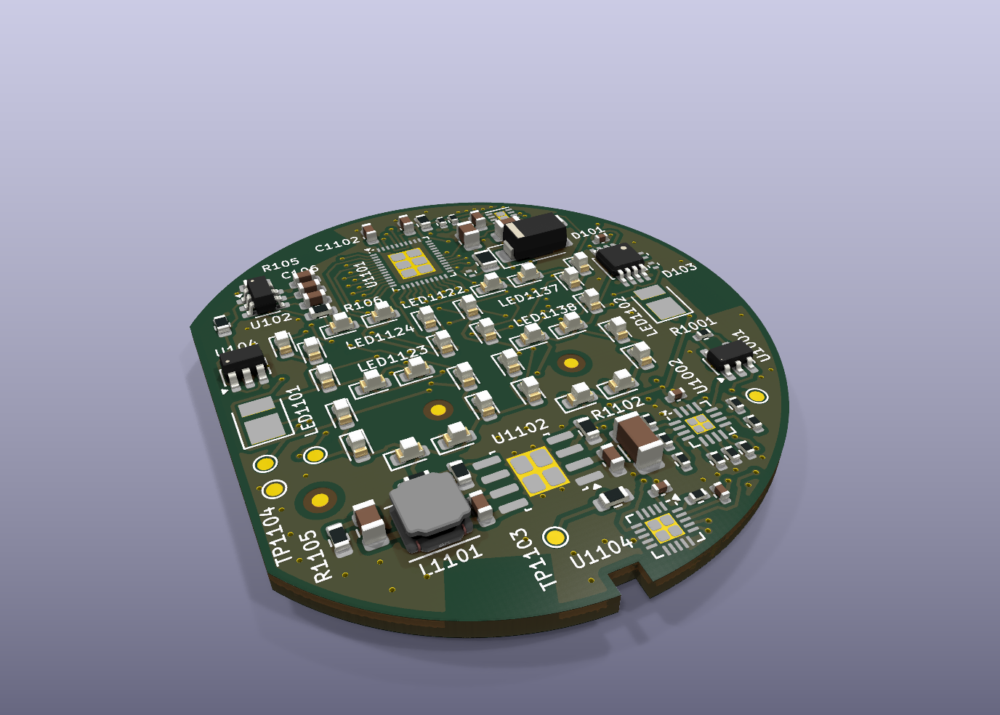
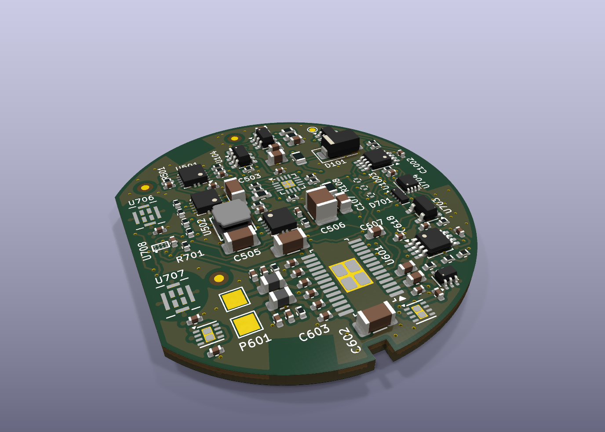
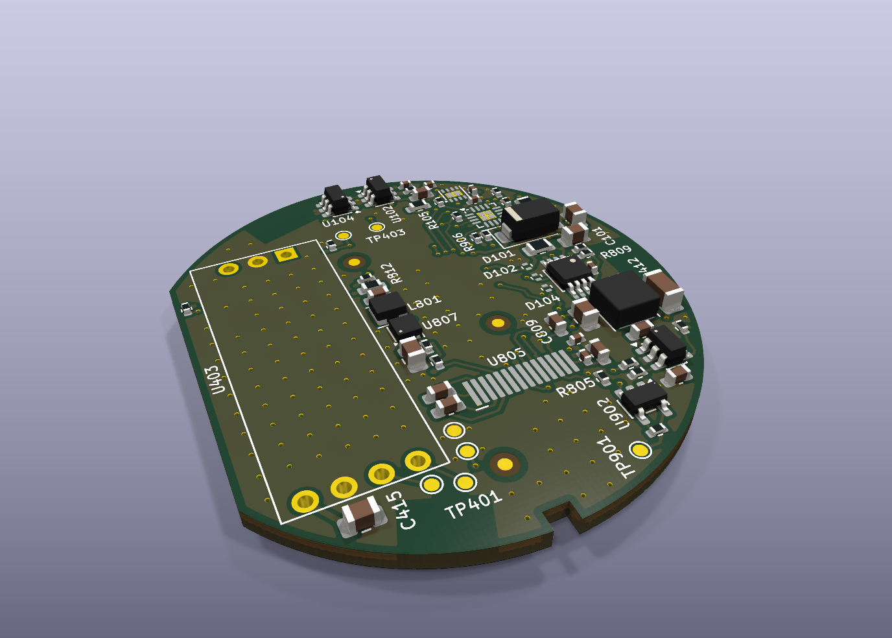
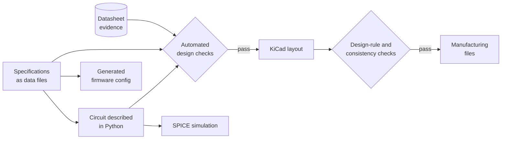

# Smart Vent: hardware as code

**A connected HVAC vent that controls airflow room by room, built from one main board and a family of snap-in sensor modules.** It extends a design covered by a granted U.S. patent (*Distributed Zone Control System*).

> This is a portfolio overview. The design itself (schematics, layouts, firmware, specifications) is private to the client. Only 3D renders and the general approach are shown here.

  

## What it does

- **Room-level airflow control:** a motorised damper and fans, coordinated across several vents in a home.
- **Sensing:** room climate and supply-air readings feed the control loop.
- **Snap-in modules:** sensor pucks (light, audio, occupancy) click into the vent, so one vent can be configured for different rooms.
- **Connected and on-device:** wireless control, with on-device voice and keyword spotting.
- **Safe by default:** the board fails to a known-safe state through power-up, resets and module hot-plugging.

| Main board, underside | Light module |
| --- | --- |
|  |  |

| Audio module | Occupancy module |
| --- | --- |
|  |  |

## How it's built

The boards aren't drawn by hand. They're generated by a pipeline, and each stage has to pass before the next one runs:

- **Specifications as the source of truth.** Parts, pin assignments and design rules live in data files. The circuit, the firmware configuration and the simulation setup are all generated from them, so they can't drift apart.
- **Checked against datasheets.** Every rating a check relies on points to a specific page of the part's datasheet, so the numbers can be verified rather than remembered.
- **Checks that prove they work.** Each automated check ships with tests that deliberately break a known-good design, to show the check actually catches the problem.
- **Simulated before it's built.** The worst electrical cases are simulated in SPICE before boards are ordered, and the results drive component choices.
- **Firmware before hardware.** The firmware is developed against a simulated version of the board, so it's ready when boards arrive.
- **Decisions on record.** Every part choice is written down with the reasoning behind it.

## Status

The original single-vent prototype was built and validated. The current multi-vent generation went through layout and review, and prototype boards were manufactured in November 2026.

## Tools

Python · SKiDL · KiCad · SPICE · ESP-IDF · Wokwi · pytest
